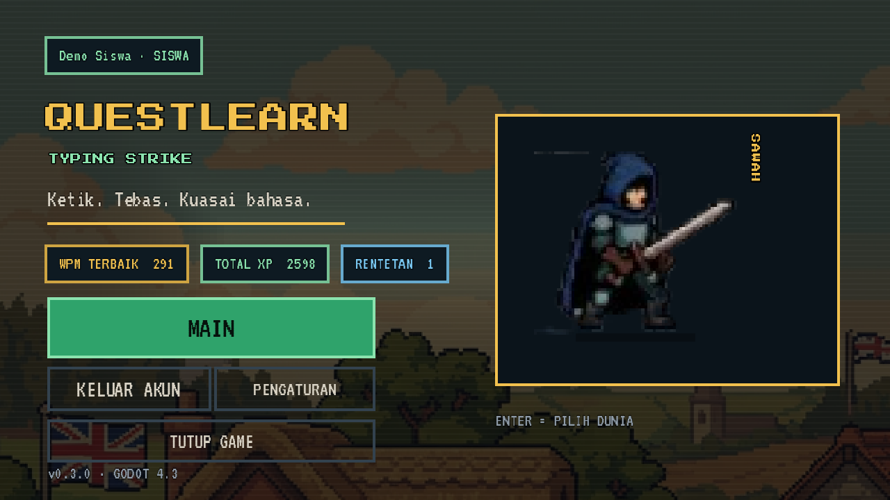
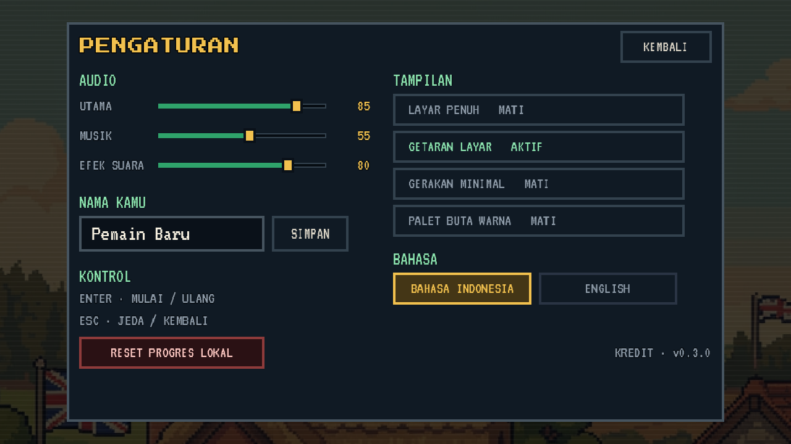
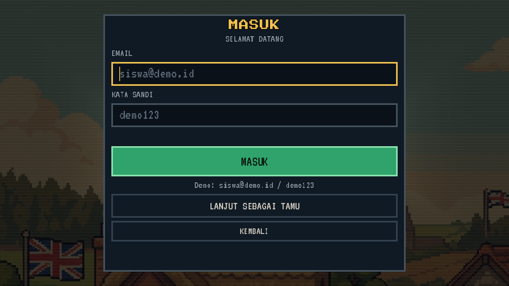
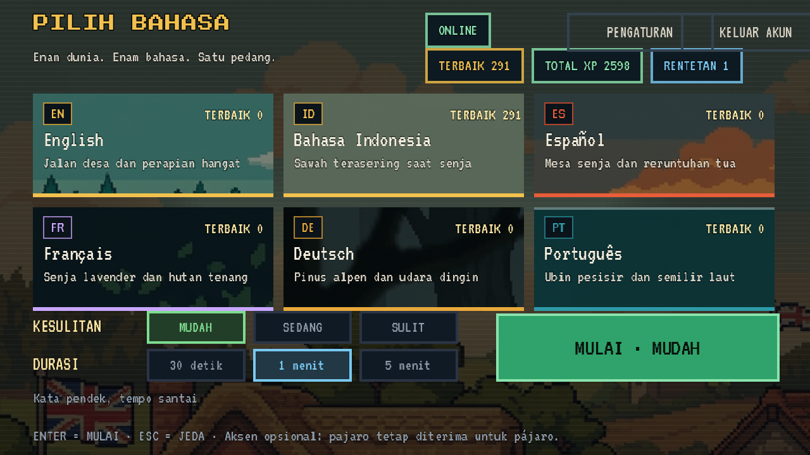
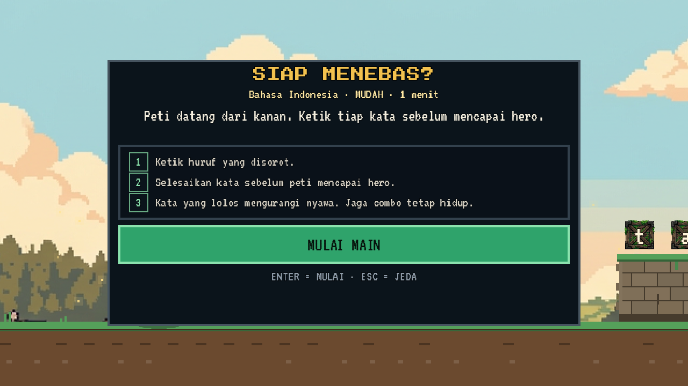
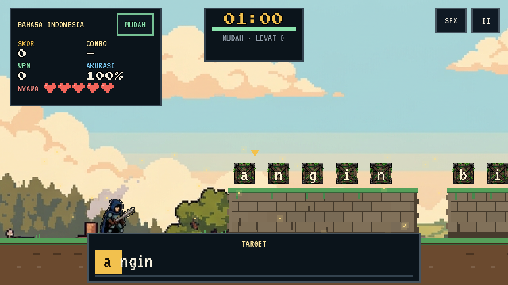
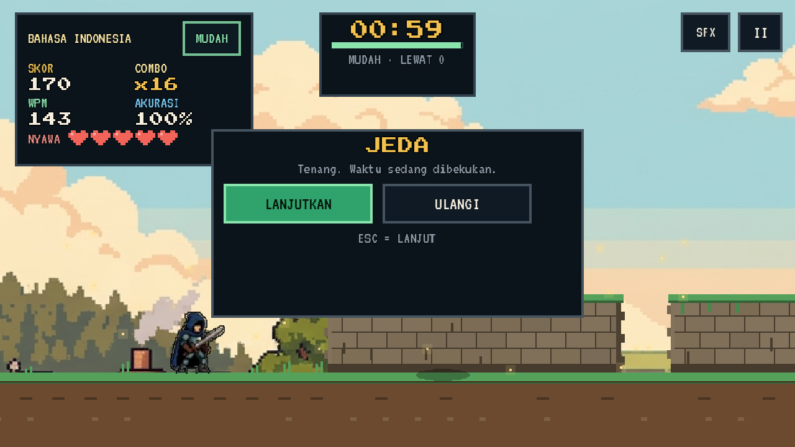
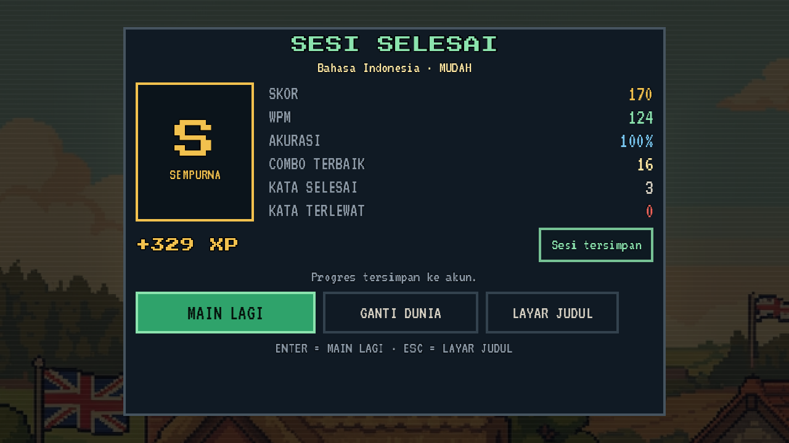

# QuestLearn Typing - Godot 4 client

Arena typing pixel-art berbahasa Indonesia/Inggris, dibuat dengan **Godot 4.3**.
Seluruh layar (judul, login, pilih dunia, arena, pause, game over, hasil,
pengaturan) adalah node Godot asli. Game tetap bisa dimainkan **tanpa backend**
sebagai tamu, lalu menyinkronkan hasil saat login.

## Tampilan

| Judul | Pengaturan |
| --- | --- |
|  |  |

| Login | Pilih dunia |
| --- | --- |
|  |  |

| Siap main | Arena |
| --- | --- |
|  |  |

| Pause | Hasil |
| --- | --- |
|  |  |

Screenshot dibuat otomatis dengan `-- --shots`.

## Fitur

- 6 dunia bahasa: English, Bahasa Indonesia, Español, Français, Deutsch,
  Português. Masing-masing punya palette, background, crate, ambient, dan
  fallback word bank sendiri.
- 3 tingkat kesulitan (MUDAH / SEDANG / SULIT) dan durasi 30 detik, 1 menit,
  atau 5 menit.
- Mode tamu/offline penuh: tidak perlu backend untuk demo. Hasil run disimpan
  lokal dan bisa diantrikan untuk sinkronisasi.
- Login backend opsional: JWT disimpan di `user://session.json`; hasil dikirim
  ke `/typing/submit` dan XP/riwayat diperbarui.
- HUD baru: skor, combo, WPM, akurasi, nyawa, timer, target word, ready/pause/
  game-over overlay, vignette, dan scanline.
- Hero dinormalisasi ke canvas 96x96, outline shader, slash arc, crate shards,
  combo milestone, screen shake, dan ambient per dunia.
- Pengaturan tersimpan: volume master/musik/SFX, mute, nama tamu, bahasa UI,
  fullscreen, screen shake, reduced motion, colorblind palette, dan reset
  progres dengan konfirmasi.
- Font: Press Start 2P untuk display, VT323 untuk body. Keduanya pixel-friendly.

## Menjalankan

Butuh **Godot 4.3**. Jika executable tidak ada di PATH:

```powershell
& "C:\Users\dell\godot-tools\Godot_v4.3-stable_win64_console.exe" --path game\questlearn
```

Atau buka folder `game/questlearn` lewat Godot Project Manager.

Backend opsional (Quarkus) di `http://localhost:8080/api`:

- demo: `siswa@demo.id` / `demo123`
- akun siswa seed: `*@gmail.com` / `siswa123`

Alur lengkap: judul -> login/tamu -> pilih dunia + difficulty + durasi -> arena
-> hasil -> main lagi / ganti dunia / judul. Tanpa backend, pilih **Lanjut
sebagai tamu**.

## Kontrol

| Tombol | Aksi |
| --- | --- |
| Huruf / angka / spasi | Menebas crate yang menyala |
| Enter | Mulai run / main lagi dari hasil |
| Esc | Pause/resume; kembali dari layar menu |
| Mouse | Tombol menu, SFX mute, pause |

Huruf beraksen (á, ñ, ü, ç, ...) bisa diketik tanpa aksen. Pencocokan memakai
normalisasi yang sama dengan versi web.

## Struktur

| File | Isi |
| --- | --- |
| `scripts/main.gd` | shell aplikasi: judul, login, pilih dunia, sesi, hasil, pengaturan, shots |
| `scripts/arena.gd` | gameplay, spawn crate, kamera, tebing, skor, submit |
| `scripts/hud.gd` | HUD + overlay ready/pause/game-over |
| `scripts/api.gd` | autoload HTTP ke backend (login, dunia, typing) |
| `scripts/loc.gd` | string EN/ID |
| `scripts/profile.gd` | settings, profil lokal, XP, best score, antrean offline |
| `scripts/worlds.gd` | 6 dunia, palette, background, crate, fallback words |
| `scripts/ui_kit.gd` | theme, font, panel, tombol, chip, vignette, slider |
| `scripts/arena_fx.gd` | partikel, teks skor, slash arc |
| `scripts/sfx.gd` | SFX runtime (tanpa file audio), mute/SFX bus |
| `tests/smoke.gd` | smoke test backend + arena |
| `tests/ui_smoke.gd` | smoke test alur tamu/offline |

Dokumentasi seni dan aset:

- [`ART_DIRECTION.md`](ART_DIRECTION.md)
- [`ASSET_BRIEF.md`](ASSET_BRIEF.md)
- [`ASSET_LICENSES.md`](ASSET_LICENSES.md)

## Build Windows

```powershell
& "C:\Users\dell\godot-tools\Godot_v4.3-stable_win64_console.exe" --headless `
  --path game\questlearn --export-release "Windows Desktop" `
  game\questlearn\build\windows\QuestLearnTyping.exe
```

Hasil: satu file `game/questlearn/build/windows/QuestLearnTyping.exe` dengan PCK
tertanam. Export membutuhkan Godot export templates 4.3.

## Test otomatis

```powershell
# Backend harus hidup di :8080
& "C:\Users\dell\godot-tools\Godot_v4.3-stable_win64_console.exe" --headless `
  --path game\questlearn res://tests/smoke.tscn

# Alur tamu/offline, tidak butuh backend
& "C:\Users\dell\godot-tools\Godot_v4.3-stable_win64_console.exe" --headless `
  --path game\questlearn res://tests/ui_smoke.tscn
```

Smoke backend mengecek login, 6 dunia, kata `/typing/start`, arena, 6 kata,
kehilangan nyawa, kontrak payload, dan `/typing/submit`. UI smoke mengecek 13
langkah alur tamu sampai result dan penyimpanan XP lokal.

Screenshot semua layar (butuh display):

```powershell
& "C:\Users\dell\godot-tools\Godot_v4.3-stable_win64_console.exe" `
  --path game\questlearn -- --shots
# hasil: %APPDATA%/Godot/app_userdata/QuestLearn Typing/shots
```

## Catatan demo

- Musik belum diimplementasikan; baru ada SFX prosedural. Bus `Music` sudah
  disiapkan.
- Backend pengembangan memakai H2, CORS terbuka, dan JWT secret hardcoded. Ini
  bukan konfigurasi produksi publik.
- WPM/skor masih dipercaya dari client. Validasi anti-cheat server belum menjadi
  bagian dari scope demo.
- Aset placeholder perlu dicek lisensinya sebelum rilis publik; lihat
  `ASSET_LICENSES.md`.
